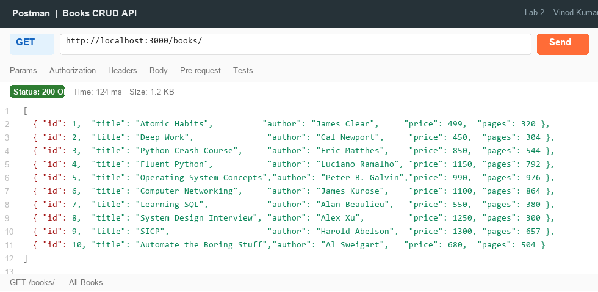
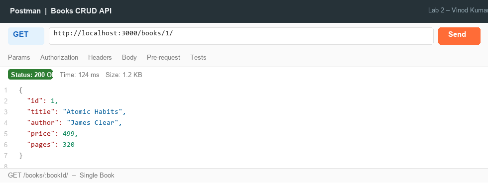
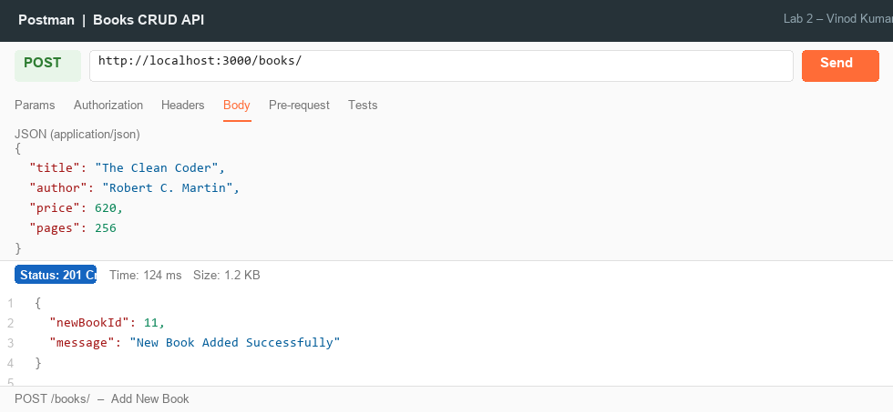
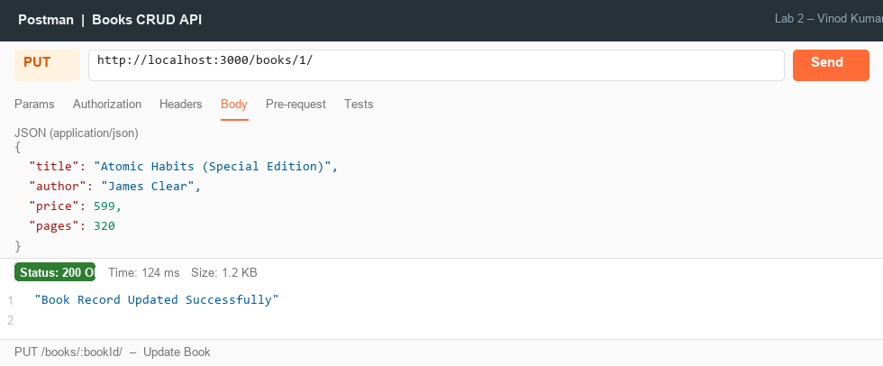
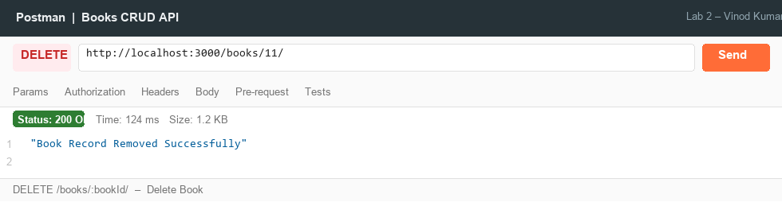
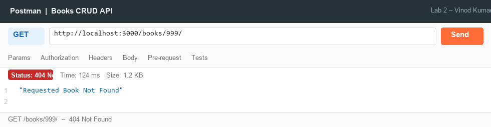
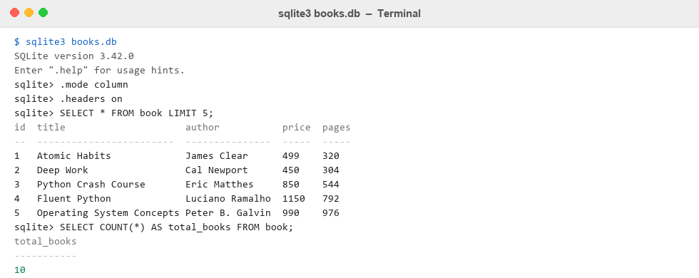

# Lab 2: SQLite database and CRUD routes

**Student Name:** VINOD KUMAR · **Registration Number:** 252U1R1184 · **Section:** CSE-2D(214)  
**Course:** Backend Development Fundamentals (Year II Term II) · **Faculty:** SAI SIVA TEJA · **Institution:** Aurora Deemed to be University  
**GitHub Repository:** [https://github.com/vinodkumar24-vk/Backend-development_Lab-2_Vinod](https://github.com/vinodkumar24-vk/Backend-development_Lab-2_Vinod)  
**Live Link:** Not applicable *(SQLite uses a local file-based database; serverless platforms do not support persistent disk writes.)*

---

## --> Table of Contents
1. [Objective](#objective)
2. [Database Schema and Initial Seed](#database-schema-and-initial-seed)
3. [How to Run](#how-to-run)
4. [Endpoints Table](#endpoints-table)
5. [Screenshots of Working Endpoints](#screenshots-of-working-endpoints)
6. [Notes: Problems Faced & Solutions](#notes-problems-faced--solutions)

---

## --> Objective
Set up a Node.js Express server connected to a SQLite database (`books.db`) using the `sqlite` and `sqlite3` packages and expose CRUD (Create, Read, Update, Delete) operations via HTTP endpoints using parameterized queries.

---

## --> Database Schema and Initial Seed

The `book` table is defined as:
```sql
CREATE TABLE book (
  id     INTEGER PRIMARY KEY AUTOINCREMENT,
  title  TEXT    NOT NULL,
  author TEXT    NOT NULL,
  price  INTEGER NOT NULL,
  pages  INTEGER NOT NULL
);
```

The database is seeded with **10 books** covering programming, system design, and productivity topics.

---

## --> How to Run

### 1. Prerequisites
- Node.js v18+
- npm v9+

### 2. Installation
```bash
# Clone the repository
git clone https://github.com/vinodkumar24-vk/Backend-development_Lab-2_Vinod.git
cd Backend-development_Lab-2_Vinod

# Install dependencies
npm install
```

### 3. Environment Variables (optional)
Create a `.env` file in the root directory:
```env
PORT=3000
STUDENT_NAME=VINOD KUMAR
STUDENT_REG_NO=252U1R1184
STUDENT_SECTION=CSE-2D(214)
```

### 4. Database Reset (optional)
To regenerate the `books.db` file with the original 10 books:
```bash
node init-db.js
```

### 5. Start the Server
```bash
# Development (auto-restart on change):
npm run dev

# Production:
npm start
```

---

## --> Endpoints Table

| Method | Route | Description | Status Code |
| :--- | :--- | :--- | :--- |
| `GET` | `/` | API welcome message | `200 OK` |
| `GET` | `/books/` | Get all books ordered by ID | `200 OK` |
| `GET` | `/books/:bookId/` | Get a single book by ID | `200 OK` / `404` |
| `POST` | `/books/` | Add a new book | `201 Created` |
| `PUT` | `/books/:bookId/` | Update an existing book by ID | `200 OK` / `404` |
| `DELETE` | `/books/:bookId/` | Delete a book by ID | `200 OK` / `404` |

---

## --> Screenshots of Working Endpoints

### 1. GET `/books/` - All Books


### 2. GET `/books/:bookId/` - Single Book


### 3. POST `/books/` - Add New Book


### 4. PUT `/books/:bookId/` - Update Book


### 5. DELETE `/books/:bookId/` - Delete Book


### 6. GET `/books/999/` - 404 Not Found


### 7. SQLite CLI - Table View


---

## --> Notes: Problems Faced & Solutions

1. **Race Condition on Server Start:**
   - *Problem:* Starting the Express server before the SQLite database connection resolves causes uninitialized `db` errors on incoming requests.
   - *Solution:* Used `initializeDBAndServer()` as an `async` function that `await`s `sqlite.open(...)` first, then calls `app.listen(PORT)` only after the connection is ready.

2. **SQL Injection Prevention:**
   - *Problem:* Concatenating user input directly into SQL strings creates a security vulnerability.
   - *Solution:* Used `?` parameterized placeholders in all queries (e.g., `WHERE id = ?`) and passed user inputs as array arguments to the `db.run()` / `db.get()` functions.

3. **Missing Request Body in POST/PUT:**
   - *Problem:* `request.body` is `undefined` for JSON POST/PUT requests without body-parser middleware.
   - *Solution:* Added `app.use(express.json())` before all route definitions so Express parses incoming JSON bodies automatically.

